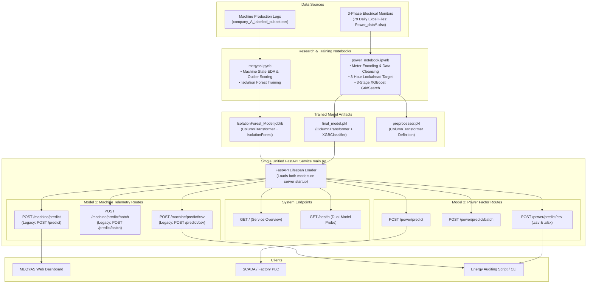

# MEQYAS AI — Unified Industrial Energy Intelligence & Predictive Anomaly Detection

[](https://www.python.org/)
[](https://fastapi.tiangolo.com/)
[](https://xgboost.readthedocs.io/)
[](https://scikit-learn.org/)
[](#)

**MEQYAS AI** is the core artificial intelligence and telemetry analytics module of the **MEQYAS** smart industrial energy platform. 

This repository provides a **single unified FastAPI application** that concurrently serves two production machine learning models:
1. **Model 1: Machine Telemetry Anomaly Detector ([`model/IsolationForest_Model.joblib`](file:///D:/meqyas_api/model/IsolationForest_Model.joblib))**: An unsupervised Isolation Forest pipeline monitoring machine operational states, production cycles, and power surges with dynamic continuous scoring ($0\%–100\%$).
2. **Model 2: Predictive Power Factor Risk Forecaster ([`model/final_model.pkl`](file:///D:/meqyas_api/model/final_model.pkl))**: A supervised 3-stage tuned XGBoost pipeline predicting the risk of facility Power Factor falling below `0.90` within an advance **3-hour window**.

Both models are loaded into memory once during application startup via FastAPI's **Lifespan** mechanism, eliminating per-request loading latency and ensuring high-throughput inference.

---

## Table of Contents

- [System Architecture](#system-architecture)
- [Repository Structure](#repository-structure)
- [Core Models & Framework Overview](#core-models--framework-overview)
  - [Model 1: Machine Telemetry Anomaly Detection (Isolation Forest)](#model-1-machine-telemetry-anomaly-detection-isolation-forest)
  - [Model 2: Predictive Power Factor Risk Model (XGBoost)](#model-2-predictive-power-factor-risk-model-xgboost)
- [Unified FastAPI Application Architecture](#unified-fastapi-application-architecture)
  - [Lifespan Startup Loading & Health Probing](#lifespan-startup-loading--health-probing)
  - [API Endpoints Directory](#api-endpoints-directory)
- [API Reference & Usage Examples](#api-reference--usage-examples)
  - [1. System & Health Probes](#1-system--health-probes)
    - [`GET /` — Service Overview & Model Catalog](#get---service-overview--model-catalog)
    - [`GET /health` — Readiness & Multi-Model Health Check](#get-health--readiness--multi-model-health-check)
  - [2. Model 1: Machine Anomaly Detection Endpoints](#2-model-1-machine-anomaly-detection-endpoints)
    - [`POST /machine/predict` — Single Machine Reading](#post-machinepredict--single-machine-reading)
    - [`POST /machine/predict/batch` — Batch Machine Readings](#post-machinepredictbatch--batch-machine-readings)
    - [`POST /machine/predict/csv` — CSV Dataset File Upload](#post-machinepredictcsv--csv-dataset-file-upload)
  - [3. Model 2: Power Factor Risk Prediction Endpoints](#3-model-2-power-factor-risk-prediction-endpoints)
    - [`POST /power/predict` — Single 3-Phase Reading](#post-powerpredict--single-3-phase-reading)
    - [`POST /power/predict/batch` — Batch Power Readings](#post-powerpredictbatch--batch-power-readings)
    - [`POST /power/predict/csv` — Power CSV / Excel File Upload](#post-powerpredictcsv--power-csv--excel-file-upload)
- [Direct Python Usage (SDK / Scripting)](#direct-python-usage-sdk--scripting)
- [CLI Tool (`predict.py`)](#cli-tool-predictpy)
- [Automated Testing Suite](#automated-testing-suite)
- [Installation & Local Setup](#installation--local-setup)
- [Deployment Configuration](#deployment-configuration)

---

## System Architecture



---

## Repository Structure

```
meqyas_api/
├── data/
│   └── raw/
│       ├── Power_data/             # 79 daily industrial power monitor files (.xlsx)
│       └── company_A_labelled_subset.csv # Multi-machine production & power telemetry
├── model/
│   ├── final_model.pkl             # Trained XGBoost pipeline (ColumnTransformer + XGBClassifier)
│   ├── preprocessor.pkl            # Preprocessing ColumnTransformer configuration
│   └── IsolationForest_Model.joblib # Trained Isolation Forest pipeline
├── notebook/
│   ├── meqyas.ipynb                # Research Notebook 1: Isolation Forest machine anomaly detection
│   └── power_notebook.ipynb        # Research Notebook 2: 3-Phase power cleaning & XGBoost tuning
├── main.py                         # Unified FastAPI application integrating both ML models
├── predict.py                      # Standalone CLI tool for machine telemetry batch prediction
├── test_api.py                     # Comprehensive automated test suite for both ML models
├── requirements.txt                # Pinned production package dependencies
└── README.md                       # Comprehensive system documentation
```

---

## Core Models & Framework Overview

| Dimension | Model 1: Machine Telemetry Anomaly Detection | Model 2: Predictive Power Factor (Final Model) |
|---|---|---|
| **Primary File** | [`model/IsolationForest_Model.joblib`](file:///D:/meqyas_api/model/IsolationForest_Model.joblib) | [`model/final_model.pkl`](file:///D:/meqyas_api/model/final_model.pkl) |
| **Training Notebook** | [`notebook/meqyas.ipynb`](file:///D:/meqyas_api/notebook/meqyas.ipynb) | [`notebook/power_notebook.ipynb`](file:///D:/meqyas_api/notebook/power_notebook.ipynb) |
| **Framework** | Scikit-Learn 1.9.1 (`Pipeline`, `ColumnTransformer`) | XGBoost 3.4.1 & Scikit-Learn 1.9.1 (`Pipeline`) |
| **Algorithm** | Isolation Forest (`n_estimators=100`, `contamination=0.01`) | XGBoost Classifier (`n_estimators=800`, `lr=0.03`, `max_depth=5`) |
| **Learning Paradigm**| Unsupervised Anomaly Detection | Supervised Binary Classification |
| **Target Variable** | Decision boundary outlier score (`1` = normal, `-1` = anomaly) | Binary ($0/1$): Will $PF < 0.90$ within the next 3 hours? |
| **Input Features** | `asset`, `status`, `product`, `items`, `power_avg`, `alarm` | 12 features: 3-phase $V$, $I$, $P$, $Q$, $PF$, $Freq$, $hour$, $Q/P$ ratio |
| **Primary Use Case** | Machine idling waste, motor wear, and sensor faults | Utility penalty avoidance & automated capacitor bank dispatch |

---

### Model 1: Machine Telemetry Anomaly Detection (Isolation Forest)

The **Isolation Forest** pipeline operates on machine operational telemetry:
- **Preprocessing**:
  - `numeric`: `StandardScaler` applied to `items`, `power_avg`, `alarm`.
  - `categorical`: `OneHotEncoder(handle_unknown='ignore')` applied to `asset`, `status`, `product`.
- **Dynamic Continuous Anomaly Scoring**:
  - Raw `decision_function()` scores are calibrated against baseline empirical bounds (`-0.06802` to `0.23254`).
  - Normal inliers scale smoothly from $0.0\%$ to $50.0\%$.
  - Outliers scale from $50.0\%$ to $100.0\%$ proportionally with operational telemetry severity (e.g. active alarm signals, power spikes $> 10\text{ kW}$, idle energy draw).

---

### Model 2: Predictive Power Factor Risk Model (XGBoost)

The **Final Model** predicts whether a facility's power factor is at risk of falling below **0.90** within **3 hours**:
- **Preprocessing Pipeline**:
  - `num`: `SimpleImputer(strategy='median')` followed by `StandardScaler` across 10 numerical features (`volt_A`, `volt_B`, `volt_C`, `I_A`, `I_B`, `I_C`, `Total_Active_Power`, `Total_Reactive_Power`, `Total_Power_Factor`, `Freq`).
  - `pass`: `SimpleImputer(strategy='median')` on `Q_P_ratio` and `hour`.
- **Smart Hardware Preprocessing**:
  - **Meter Offset (+1) Auto-Decoding**: Meter-encoded values ($1.0–2.0$) or physical values ($0.0–1.0$) are normalized automatically.
  - **Auto Hour Derivation**: Parsed from `Timestamp` or inferred from clock time.
  - **Auto $Q/P$ Ratio**: Automatically computed as $Q / (|P| + 10^{-9})$ if omitted.
  - **Hardware Aliases**: Direct support for meter abbreviations (`P_T`, `Q_T`, `FP_T`, `Frec`).

---

## Unified FastAPI Application Architecture

### Lifespan Startup Loading & Health Probing

Both models are loaded simultaneously when Uvicorn starts the server using FastAPI's `@asynccontextmanager lifespan`:

```python
@asynccontextmanager
async def lifespan(app: FastAPI):
    # Load Model 1 (Isolation Forest) and Model 2 (XGBoost) into memory
    load_all_models()
    yield
    # Clean shutdown
```

This architecture ensures:
1. **Zero Cold-Start Latency**: Models are resident in RAM before accepting incoming requests.
2. **Resilience**: If a model file is missing or corrupted, the service logs the error and `/health` reports `"degraded"` status without crashing the process.

### API Endpoints Directory

| Category | Endpoint | HTTP Method | Purpose |
|---|---|---|---|
| **System** | `/` | `GET` | Service overview, model registry, and route directory |
| **System** | `/health` | `GET` | Health check verifying readiness of both models |
| **Model 1** | `/machine/predict` | `POST` | Single machine reading anomaly prediction |
| **Model 1** | `/machine/predict/batch` | `POST` | Batch machine telemetry prediction |
| **Model 1** | `/machine/predict/csv` | `POST` | CSV file upload for machine anomaly scoring |
| **Model 1 (Legacy)** | `/predict` | `POST` | Backward-compatible alias for `/machine/predict` |
| **Model 1 (Legacy)** | `/predict/batch` | `POST` | Backward-compatible alias for `/machine/predict/batch` |
| **Model 1 (Legacy)** | `/predict/csv` | `POST` | Backward-compatible alias for `/machine/predict/csv` |
| **Model 2** | `/power/predict` | `POST` | Single 3-phase reading 3-hour Low PF risk forecasting |
| **Model 2** | `/power/predict/batch` | `POST` | Batch 3-phase readings Low PF risk forecasting |
| **Model 2** | `/power/predict/csv` | `POST` | Upload power monitoring `.csv` or `.xlsx` files |

---

## API Reference & Usage Examples

### 1. System & Health Probes

#### `GET /` — Service Overview & Model Catalog
```bash
curl -X GET "http://localhost:8000/"
```

**Response:**
```json
{
  "service": "MEQYAS AI — Unified Industrial Intelligence API",
  "version": "2.0.0",
  "status": "online",
  "models": {
    "model_1_machine_anomaly": {
      "name": "IsolationForest_Model.joblib",
      "framework": "Scikit-Learn",
      "purpose": "Machine operational telemetry anomaly detection",
      "loaded": true,
      "default_threshold_pct": 50.0
    },
    "model_2_power_factor": {
      "name": "final_model.pkl",
      "framework": "XGBoost + Scikit-Learn Pipeline",
      "purpose": "Predictive Low Power Factor (< 0.90) risk forecasting (3 hours ahead)",
      "loaded": true,
      "default_threshold": 0.5
    }
  },
  "docs_url": "/docs",
  "redoc_url": "/redoc"
}
```

#### `GET /health` — Readiness & Multi-Model Health Check
```bash
curl -X GET "http://localhost:8000/health"
```

**Response:**
```json
{
  "status": "healthy",
  "model_loaded": true,
  "model_file": "D:\\meqyas_api\\model\\IsolationForest_Model.joblib",
  "models": {
    "machine_anomaly_model": {
      "loaded": true,
      "file": "IsolationForest_Model.joblib",
      "error": null
    },
    "power_factor_model": {
      "loaded": true,
      "file": "final_model.pkl",
      "error": null,
      "features_count": 12
    }
  }
}
```

---

### 2. Model 1: Machine Anomaly Detection Endpoints

#### `POST /machine/predict` — Single Machine Reading

##### Request Example (Normal Reading):
```bash
curl -X POST "http://localhost:8000/machine/predict" \
     -H "Content-Type: application/json" \
     -d '{
       "asset": 0,
       "items": 4.0,
       "status": 2,
       "power_avg": 2.0,
       "alarm": 0,
       "product": 0
     }'
```

**Response:**
```json
{
  "is_anomaly": false,
  "prediction": "normal",
  "anomaly_percentage": 25.47,
  "raw_score": 0.114097,
  "message": "Reading is normal with 25.47% anomaly score.",
  "anomaly_reasons": null
}
```

##### Request Example (Active Alarm Anomaly):
```bash
curl -X POST "http://localhost:8000/machine/predict" \
     -H "Content-Type: application/json" \
     -d '{
       "asset": "machine_1",
       "items": 4.0,
       "status": "alarm",
       "power_avg": 2.5,
       "alarm": 1,
       "product": "product_1"
     }'
```

**Response:**
```json
{
  "is_anomaly": true,
  "prediction": "anomaly",
  "anomaly_percentage": 77.44,
  "raw_score": 0.073976,
  "message": "Anomaly detected: Active machine alarm signal (alarm=1) with 77.44% anomaly score.",
  "anomaly_reasons": [
    "Active machine alarm signal (alarm=1)"
  ]
}
```

#### `POST /machine/predict/batch` — Batch Machine Readings
```bash
curl -X POST "http://localhost:8000/machine/predict/batch" \
     -H "Content-Type: application/json" \
     -d '{
       "readings": [
         { "asset": 0, "items": 4.0, "status": 2, "power_avg": 2.0, "alarm": 0, "product": 0 },
         { "asset": 1, "items": 0.0, "status": 3, "power_avg": 15.0, "alarm": 1, "product": 2 }
       ],
       "threshold": 50.0
     }'
```

**Response:**
```json
{
  "total_readings": 2,
  "anomalies_count": 1,
  "normal_count": 1,
  "anomaly_rate_pct": 50.0,
  "average_anomaly_percentage": 54.52,
  "results": [ ... ]
}
```

#### `POST /machine/predict/csv` — CSV Dataset File Upload
```bash
curl -X POST "http://localhost:8000/machine/predict/csv?threshold=50.0" \
     -H "Accept: application/json" \
     -F "file=@data/raw/company_A_labelled_subset.csv"
```

---

### 3. Model 2: Power Factor Risk Prediction Endpoints

#### `POST /power/predict` — Single 3-Phase Reading

##### Request Example (Normal Power Factor $PF = 0.95$):
```bash
curl -X POST "http://localhost:8000/power/predict" \
     -H "Content-Type: application/json" \
     -d '{
       "volt_A": 126.8,
       "volt_B": 125.4,
       "volt_C": 126.2,
       "I_A": 0.35,
       "I_B": 0.42,
       "I_C": 0.21,
       "Total_Active_Power": 0.087,
       "Total_Reactive_Power": 0.010,
       "Total_Power_Factor": 0.95,
       "Freq": 60.0,
       "hour": 14
     }'
```

**Response:**
```json
{
  "prediction": "Normal Power Factor",
  "is_low_pf_risk": false,
  "risk_probability": 0.031,
  "risk_percentage": 3.1,
  "threshold_used": 0.5,
  "actual_power_factor": 0.95,
  "computed_q_p_ratio": 0.1149,
  "message": "NORMAL: Power factor risk is low (3.1%). Operating stably above 0.90 (Current PF: 0.95)."
}
```

##### Request Example (Using Hardware Meter Aliases: `P_T`, `Q_T`, `FP_T`, `Frec`):
```bash
curl -X POST "http://localhost:8000/power/predict" \
     -H "Content-Type: application/json" \
     -d '{
       "volt_A": 126.5,
       "volt_B": 125.0,
       "volt_C": 126.0,
       "I_A": 0.30,
       "I_B": 0.35,
       "I_C": 0.20,
       "P_T": 0.080,
       "Q_T": 0.012,
       "FP_T": 1.94,
       "Frec": 60.0,
       "Timestamp": "2024-08-06 10:15:00"
     }'
```

#### `POST /power/predict/batch` — Batch Power Readings
```bash
curl -X POST "http://localhost:8000/power/predict/batch" \
     -H "Content-Type: application/json" \
     -d '{
       "readings": [
         {
           "volt_A": 126.8, "volt_B": 125.4, "volt_C": 126.2,
           "I_A": 0.35, "I_B": 0.42, "I_C": 0.21,
           "Total_Active_Power": 0.087, "Total_Reactive_Power": 0.010,
           "Total_Power_Factor": 0.98, "Freq": 60.0, "hour": 12
         },
         {
           "volt_A": 124.0, "volt_B": 123.5, "volt_C": 124.2,
           "I_A": 0.85, "I_B": 0.90, "I_C": 0.80,
           "Total_Active_Power": 0.040, "Total_Reactive_Power": 0.090,
           "Total_Power_Factor": 0.70, "Freq": 59.95, "hour": 16
         }
       ],
       "threshold": 0.50
     }'
```

**Response:**
```json
{
  "total": 2,
  "low_pf_risk_count": 1,
  "normal_count": 1,
  "risk_rate_pct": 50.0,
  "results": [
    {
      "prediction": "Normal Power Factor",
      "is_low_pf_risk": false,
      "risk_probability": 0.0245,
      "risk_percentage": 2.45,
      "threshold_used": 0.5,
      "actual_power_factor": 0.98,
      "computed_q_p_ratio": 0.1149,
      "message": "NORMAL: Power factor risk is low (2.45%). Current PF: 0.98."
    },
    {
      "prediction": "Low Power Factor Risk (Anomaly)",
      "is_low_pf_risk": true,
      "risk_probability": 0.8924,
      "risk_percentage": 89.24,
      "threshold_used": 0.5,
      "actual_power_factor": 0.7,
      "computed_q_p_ratio": 2.25,
      "message": "ALERT: High risk (89.24%) of Power Factor dropping below 0.90 within 3 hours (Threshold: 0.50)."
    }
  ]
}
```

#### `POST /power/predict/csv` — Power CSV / Excel File Upload
Upload any daily power monitoring Excel (`.xlsx`) or CSV file:
```bash
curl -X POST "http://localhost:8000/power/predict/csv?threshold=0.50" \
     -H "Accept: application/json" \
     -F "file=@data/raw/Power_data/Monitor_Fri_Aug_09_2024.xlsx"
```

**Response:**
```json
{
  "filename": "Monitor_Fri_Aug_09_2024.xlsx",
  "total_rows": 431,
  "low_pf_risk_count": 85,
  "normal_count": 346,
  "risk_rate_pct": 19.72,
  "average_risk_probability_pct": 19.18,
  "first_50_predictions": [ ... ]
}
```

---

## Direct Python Usage (SDK / Scripting)

Both models can be used directly in Python without running an ASGI server:

### Direct Prediction with Power Factor XGBoost Pipeline:
```python
import joblib
import pandas as pd

# Load final_model pipeline
saved = joblib.load("model/final_model.pkl")
pipeline = saved["pipeline"] if isinstance(saved, dict) else saved

# 12 expected features in exact order
sample = pd.DataFrame([{
    "hour": 14,
    "volt_A": 126.8, "volt_B": 125.4, "volt_C": 126.2,
    "I_A": 0.35, "I_B": 0.42, "I_C": 0.21,
    "Total_Active_Power": 0.087,
    "Total_Reactive_Power": 0.010,
    "Total_Power_Factor": 1.95,  # Decoded meter scale
    "Freq": 60.0,
    "Q_P_ratio": 0.010 / (abs(0.087) + 1e-9)
}])

prob_low_pf = float(pipeline.predict_proba(sample)[0][1])
print(f"Low PF Risk Probability: {prob_low_pf:.2%}")
```

### Direct Prediction with Isolation Forest Pipeline:
```python
import joblib
import pandas as pd

model = joblib.load("model/IsolationForest_Model.joblib")

sample = pd.DataFrame([{
    "asset": "machine_1",
    "status": "automatic",
    "product": "product_1",
    "items": 4.0,
    "power_avg": 2.5,
    "alarm": 0
}])

pred = model.predict(sample)[0]     # 1 = normal, -1 = anomaly
raw_score = model.decision_function(sample)[0]
print("Is Anomaly:", pred == -1)
print(f"Decision Score: {raw_score:.4f}")
```

---

## CLI Tool (`predict.py`)

The standalone command-line script [`predict.py`](file:///D:/meqyas_api/predict.py) provides offline batch prediction on machine logs:

```bash
# Run on default dataset (company_A_labelled_subset.csv)
python predict.py

# Run on a custom CSV file
python predict.py --input path/to/telemetry.csv

# Save scored predictions to a new CSV file
python predict.py --input telemetry.csv --output results.csv

# Display top 20 anomalies above 50% threshold
python predict.py --top 20 --threshold 50.0
```

---

## Automated Testing Suite

The comprehensive automated test suite in [`test_api.py`](file:///D:/meqyas_api/test_api.py) executes 18 end-to-end integration tests validating both models, error handling, batch predictions, and file uploads:

```bash
# Run all 18 automated integration tests
python test_api.py
```

### Verified Test Cases:
1. Both `IsolationForest_Model.joblib` and `final_model.pkl` pipelines load during lifespan initialization without conflicts.
2. Root (`GET /`) and Health (`GET /health`) probes return overall `"healthy"` status and per-model diagnostics.
3. Machine normal, active alarm (`alarm=1`), text status (`status="alarm"`), and power surge conditions.
4. Continuous dynamic anomaly scoring with proportional severity scaling.
5. Power factor physical scale ($0.0–1.0$), meter scale ($1.0–2.0$), and hardware abbreviations (`P_T`, `Q_T`, `FP_T`, `Frec`).
6. Custom probability decision threshold behavior.
7. Real multi-row Excel power monitor upload (`data/raw/Power_data/Monitor_Fri_Aug_09_2024.xlsx`).
8. Full CSV machine dataset upload prediction (`data/raw/company_A_labelled_subset.csv`).
9. Request schema validation errors (HTTP 422 for missing required fields) and empty batch rejection (HTTP 400).

---

## Installation & Local Setup

```bash
# 1. Clone repository and navigate to root directory
cd D:\meqyas_api

# 2. Create and activate a Python virtual environment
python -m venv .venv
.venv\Scripts\Activate.ps1       # Windows PowerShell
# source .venv/bin/activate      # Linux / macOS

# 3. Install production dependencies
pip install -r requirements.txt

# 4. Run automated test suite
python test_api.py

# 5. Launch the unified FastAPI application
uvicorn main:app --host 0.0.0.0 --port 8000 --reload
# Or directly via Python
python main.py
```

Interactive documentation is available at:
- **Swagger UI**: [http://localhost:8000/docs](http://localhost:8000/docs)
- **ReDoc**: [http://localhost:8000/redoc](http://localhost:8000/redoc)

---

## Deployment Configuration

### 1. Vercel Serverless Deployment

The project is configured for serverless deployment on Vercel using `app.py` as entry point, [`vercel.json`](file:///D:/meqyas_api/vercel.json), and [`.vercelignore`](file:///D:/meqyas_api/.vercelignore):

```json
{
  "$schema": "https://openapi.vercel.sh/vercel.json",
  "functions": {
    "app.py": {
      "maxDuration": 30,
      "excludeFiles": "{data/**,notebook/**,test_*.py,predict.py,*.md}"
    }
  }
}
```

#### Bundle Optimization Strategy (Resolving `LAMBDA_SIZE_EXCEEDED`):
1. **Dependency Scope**: `requirements.txt` contains strictly production runtime dependencies for FastAPI, Scikit-learn, XGBoost, Pandas, NumPy, SciPy, Joblib, Openpyxl, and Python-multipart. Development, notebook (`ipykernel`, `ipython`, `jupyter`), plotting (`matplotlib`, `seaborn`, `pillow`), and debugger tools are omitted.
2. **Asset Exclusion**: [`.vercelignore`](file:///D:/meqyas_api/.vercelignore) and `excludeFiles` exclude non-production assets (`data/**`, `notebook/**`, test suites, CLI tools, caches) from being packaged into the serverless function archive.
3. **Artifact Retention**: Model artifacts in `model/` (`IsolationForest_Model.joblib`, `final_model.pkl`, `preprocessor.pkl`) are preserved and bundled with `app.py` and `main.py`.

#### Large Functions Fallback (If Limits Are Exceeded on Future Models):
Standard Vercel functions have a **500 MB** uncompressed bundle limit. If additional heavy deep-learning frameworks (e.g. PyTorch or Transformers) are added in the future:
1. Open the **Vercel Dashboard** and select your project.
2. Navigate to **Project Settings** $\rightarrow$ **Functions**.
3. Enable **Large Functions** (available on Vercel Pro and Enterprise plans) to increase the function bundle limit to **1 GB** or **2 GB**.

---

### 2. Environment Variables

| Environment Variable | Default | Description |
|---|---|---|
| `HOST` | `0.0.0.0` | Network binding interface for Uvicorn |
| `PORT` | `8000` | Port for the ASGI Uvicorn server |

The application uses relative paths derived from `Path(__file__).resolve().parent` to locate artifacts in `model/`, ensuring seamless operation across local machines, Docker containers, and cloud environments without path hardcoding.
